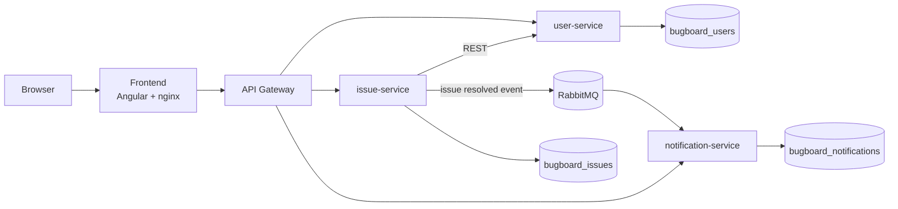

<p align="center">
  
</p>

<h1 align="center">BugBoard26</h1>

<p align="center">
  A web platform for collaborative issue tracking in software projects.
</p>

Developed for the **Software Engineering** course at the University of Naples Federico II, academic year 2025-2026.

## Features

- **Issues:** report bugs, questions, documentation requests and feature requests, with a priority and an image attachment.
- **Overview:** a list with filters for status, type and priority, plus a dashboard with statistics.
- **Assignment:** administrators assign bugs to users, and each user can see the bugs assigned to them.
- **Status workflow:** issues move through `TODO` → `IN_PROGRESS` → `RESOLVED` → `CLOSED`, and a resolved issue can be reopened.
- **Comments:** each issue has a comment section, which also shows its status change history.
- **Notifications:** the person who reported an issue is notified when it is resolved.
- **Users:** administrators create accounts and can reset passwords. Users can change their own password from their profile.

## Architecture



Each service has its own database. The gateway routes requests by path, and each service validates the JWT itself.

| Area | Technologies |
|---|---|
| Backend | Java 21, Spring Boot 3.2, Spring Cloud Gateway, Spring Security, Spring Data JPA |
| Frontend | Angular 22, TypeScript, Chart.js |
| Data and messaging | PostgreSQL 16, RabbitMQ 3.13 |
| Infrastructure | Docker, Docker Compose, AWS EC2, CloudFront |
| Quality | JUnit, Mockito, JaCoCo, SonarQube Cloud, GitHub Actions |

## Quick start

You only need [Docker](https://www.docker.com/) with Docker Compose. From the project root, run:

```bash
docker compose --profile app up -d --build
```

The application is then available at <http://localhost>.

Without a `.env` file, the development defaults apply, and the administrator account is `admin@bugboard26.com` with the password `admin-locale`. To set your own values:

```bash
cp .env.example .env
```

> The default values are for local use only. Before exposing the application to the internet, set the passwords and `JWT_SECRET` in the `.env` file.

To stop the application:

```bash
docker compose --profile app down
```

## Development

You need Java 21 and Node.js 24.

```bash
# From the project root: start PostgreSQL and RabbitMQ only
docker compose up -d

# From Backend/: build all modules once
./mvnw install -DskipTests

# From Backend/: run each service in its own terminal
./mvnw -pl user-service spring-boot:run
./mvnw -pl issue-service spring-boot:run
./mvnw -pl notification-service spring-boot:run
./mvnw -pl gateway spring-boot:run

# From Frontend/
npm install
npm start
```

The frontend runs at <http://localhost:4200> and forwards API requests to the gateway on port 8080.

| Service | Port |
|---|---|
| gateway | 8080 |
| user-service | 8081 |
| issue-service | 8082 |
| notification-service | 8083 |
| PostgreSQL | 5433 |
| RabbitMQ (management UI) | 15672 |

## Tests

The backend unit tests don't need any running services. From `Backend/`, run:

```bash
./mvnw test
```

Each module's coverage report is in `target/site/jacoco/index.html`.

## Repository structure

| Path | Contents |
|---|---|
| `Backend/` | Maven project with the `common`, `user-service`, `issue-service`, `notification-service` and `gateway` modules |
| `Frontend/` | Angular application |
| `docker/` | Database initialization script |
| `docker-compose.yml` | Starts the whole system |
| `.github/workflows/` | Automated SonarQube Cloud analysis |

## Authors

- Fabio Conte
- Andrea Capuozzo

## License

Distributed under the MIT License. See the [LICENSE](LICENSE) file.
